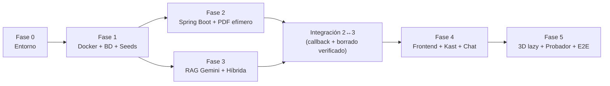

# KEY STREET — PROGRESS

> Checklist atómico y ejecutable del [PLAN.md](./PLAN.md). Marca `[x]` al completar cada sub-tarea **solo después** de que pase su verificación.
> Shell de referencia: **PowerShell 7 (`pwsh`)** en Windows. Todos los comandos se ejecutan desde la raíz del repo salvo que se indique `cd`.

## Estado general

| Fase | Nombre | Depende de | Estado |
|---|---|---|---|
| 0 | Prerrequisitos del entorno | — | ✅ Completa |
| 1 | Infraestructura Docker + BD + Seeds | 0 | ✅ Completa |
| 2 | Backend Spring Boot + Seguridad Multi-Tenant + Ciclo Efímero de PDF | 1 | ✅ Completa |
| 3 | FastAPI + LangChain Gemini + OCR + Búsqueda Híbrida con Citas | 1 (2 para el ciclo completo) | ✅ Completa |
| 4 | Frontend Editorial + Identidad Kast + Catálogo + WhatsApp + Chat RAG | 2, 3 | ✅ Completa |
| 5 | Módulos 3D Lazy + Probador Anatómico con Foto Efímera + E2E | 4 | ✅ Completa |

Leyenda: ⬜ Pendiente · 🟨 En curso · ✅ Completa · ⛔ Bloqueada

### Orden de ejecución



Regla de oro: **una fase no se cierra hasta que todos sus comandos de verificación pasen** y se haga commit: `git add -A; git commit -m "feat(fase-N): …"`.

---

## Fase 0 — Prerrequisitos del entorno

- [x] **0.01** Docker Desktop (WSL2) con Compose v2 en ejecución.
- [x] **0.02** JDK 21 (Temurin), Node.js 22 LTS, Python 3.11 + `uv`, Git, PowerShell 7, `mkcert`.
- [x] **0.03** (Recomendado) Excluir de OneDrive `node_modules/`, `target/`, `.venv/`, `dist/` o mover el repo a `C:\dev\KeyStreet` (ver riesgo en PLAN §13).
- [x] **0.04** Obtener `GEMINI_API_KEY` en Google AI Studio y confirmar acceso a `gemini-2.5-flash` (si no hay acceso → usar `gemini-3.8-flash`). *(Nota: `GEMINI_API_KEY` vacía en `.env`; pruebas offline de Fase 3/5 usan `AI_PROVIDER=fake`).*

**Verificación**
```powershell
docker --version; docker compose version
java -version; node -v; npm -v; python --version; uv --version; git --version; mkcert -version
$PSVersionTable.PSVersion   # debe ser 7.x
```

---

## Fase 1 — Infraestructura Docker + BD + Seeds

### 1.A Repositorio base
- [x] **1.01** `.gitignore` (`.env`, `node_modules/`, `target/`, `.venv/`, `dist/`, `infra/certs/`, `*.pdf` fuera de `tests/fixtures`, `frontend/public/mediapipe/`).
- [x] **1.02** `.gitattributes`: `* text=auto`, `*.sh text eol=lf`, `mvnw text eol=lf`, `*.cmd text eol=crlf`, binarios (`*.png *.jpg *.glb *.pdf *.task *.wasm`) como `binary`.
- [x] **1.03** `.env.example` exactamente como PLAN §4.2 (incluye `GEMINI_API_KEY`, `JWT_SECRET`, `POSTGRES_PASSWORD`, `WHATSAPP_PHONE=573000000000`).
- [x] **1.04** `scripts/gen-dev-secrets.ps1`: copia `.env.example` → `.env` si no existe y rellena `JWT_SECRET` (64 bytes base64), `INTERNAL_API_TOKEN`, `POSTGRES_PASSWORD`, `APP_DB_PASSWORD`, `RAG_DB_PASSWORD` con `RandomNumberGenerator`.
- [x] **1.05** `README.md` con arranque rápido y credenciales dev (`admin@keystreet.co` / `cliente@keystreet.co`, `KeyStreet2026!`).

### 1.B Base de datos
- [x] **1.06** `db/init/00-roles.sh` (LF, `set -euo pipefail`): crea `keystreet_app` y `keystreet_rag` `LOGIN NOSUPERUSER NOBYPASSRLS` con `APP_DB_PASSWORD` / `RAG_DB_PASSWORD`.
- [x] **1.07** `db/schema.sql` — extensiones (`vector`, `pgcrypto`, `unaccent`, `citext`) + configuración FTS `es_unaccent` + funciones `set_updated_at()` y `app_current_tenant()`.
- [x] **1.08** `db/schema.sql` — tablas `tenants`, `users`, `refresh_tokens`.
- [x] **1.09** `db/schema.sql` — tablas `brands`, `products` (columnas generadas `discount_price_cop`, `final_price_cop`, `has_discount`, `search_vector`) y `product_variants` (tallas 36–44) + índices.
- [x] **1.10** `db/schema.sql` — tablas `documents` (sin binario, `sha256_hash`, estados `PROCESSING|INDEXED|FAILED`, campos de borrado verificado) y `document_chunks` (`vector(768)`, `page_number`, `page_end`, `section_title`, `chunk_order`, `search_vector`).
- [x] **1.11** `db/schema.sql` — índice **HNSW** `ix_chunks_embedding_hnsw (embedding vector_cosine_ops) WITH (m=16, ef_construction=64)` + GIN `ix_chunks_search_gin`.
- [x] **1.12** `db/schema.sql` — `rag_audit_logs`, `whatsapp_order_intents`, triggers `updated_at`.
- [x] **1.13** `db/schema.sql` — RLS `ENABLE` + `FORCE` + política `tenant_isolation` en las 9 tablas con `tenant_id`; `GRANT`s de mínimo privilegio.
- [x] **1.14** `db/seed.sql` — tenant "Key Street" (`00000000-0000-4000-8000-000000000001`, slug `key-street`, branding, WhatsApp `573000000000`).
- [x] **1.15** `db/seed.sql` — usuarios dev con `crypt('KeyStreet2026!', gen_salt('bf', 10))`.
- [x] **1.16** `db/seed.sql` — 5 marcas (`NIK`, `ADI`, `PUM`, `NBL`, `CNV`).
- [x] **1.17** `db/seed.sql` — los **10 productos exactos** (nombres y descripciones literales, precios base de PLAN §5.4, `discount_percent = 0` inicial, `image_placeholder_paths` con `ready:false`, `model_3d_url`, `material_specs` con `palette`, `fit` y `hotspots`, `style_tags`, `badge`).
- [x] **1.18** `db/seed.sql` — `UPDATE` automático de descuentos `WHERE original_price_cop BETWEEN 170000 AND 185000` (AF1 10 %, Puma 12 %, NB 574 12 %, Converse 15 %) + bloque `DO $$` con `RAISE EXCEPTION` si ≠ 4.
- [x] **1.19** `db/seed.sql` — 90 variantes (`generate_series(36,44)`), SKU `KS-{BRAND}-{MODEL}-{TALLA}`, stock determinista.
- [x] **1.20** `db/tests/verify_seed.sql` — aserciones: extensiones, `es_unaccent`, tipo `vector(768)`, índice HNSW con `vector_cosine_ops`, 10 productos, 4 descuentos con precios finales exactos (166.500 / 162.800 / 154.000 / 144.500), 90 variantes, SKUs únicos, tallas solo 36–44.
- [x] **1.21** `db/tests/verify_rls.sql` — `SET ROLE keystreet_app;` sin tenant → 0 productos; con `set_config('app.tenant_id', …, true)` → 10; tenant inexistente → 0; `INSERT` con otro `tenant_id` → error de política.

### 1.C Docker Compose y esqueletos
- [x] **1.22** `docker-compose.yml` según PLAN §4.1 (4 servicios, `pgdata`, `pdf_tmp` tmpfs `uid=10001`, healthchecks, puertos solo en `127.0.0.1` salvo frontend, perfil `security` con ClamAV).
- [x] **1.23** Esqueleto `backend-java` (Spring Boot 3.5.x, Java 21, Actuator) + `Dockerfile` multi-stage con usuario `10001`.
- [x] **1.24** Esqueleto `rag-service` (FastAPI `/health`, `pyproject.toml` + `uv.lock`) + `Dockerfile` `python:3.11-slim` con `tesseract-ocr tesseract-ocr-spa`, usuario `10001`.
- [x] **1.25** Esqueleto `frontend` (Vite React TS) + `Dockerfile` (node:22 → nginx:alpine) + `infra/nginx/default.conf` (TLS, 80→443, proxy `/api` → `backend-java:8080`, bloqueo `/internal`, `client_max_body_size 21m`, gzip, cache inmutable para `/assets/*.js|css`).
- [x] **1.26** Certificados dev: `mkcert -cert-file infra/certs/dev.crt -key-file infra/certs/dev.key localhost 127.0.0.1`.
- [x] **1.27** `docker-compose.e2e.yml` (override `AI_PROVIDER=fake`, `PDF_TMP_TTL_MINUTES=2`).

**Verificación Fase 1**
```powershell
.\scripts\gen-dev-secrets.ps1
docker compose config --quiet                                   # sin salida = YAML válido
docker compose up -d --build
docker compose ps                                               # 4 servicios "healthy"
docker compose exec postgres psql -U postgres -d keystreet -c "\dx"
docker compose exec postgres psql -U postgres -d keystreet -v ON_ERROR_STOP=1 -f /db-tests/verify_seed.sql
docker compose exec postgres psql -U postgres -d keystreet -v ON_ERROR_STOP=1 -f /db-tests/verify_rls.sql
docker compose exec postgres psql -U postgres -d keystreet -c "SELECT name, original_price_cop, discount_percent, discount_price_cop FROM products WHERE has_discount ORDER BY original_price_cop DESC, name;"
docker compose exec postgres psql -U postgres -d keystreet -c "SELECT indexdef FROM pg_indexes WHERE indexname = 'ix_chunks_embedding_hnsw';"
curl.exe -s http://localhost:8080/actuator/health               # {"status":"UP"}
docker compose exec rag-service python -c "import urllib.request;print(urllib.request.urlopen('http://localhost:8000/health').read().decode())"
curl.exe -sI https://localhost/                                 # HTTP/1.1 200
```
Resultado esperado de la consulta de descuentos (4 filas exactas):
```
Nike Air Force 1 Low '07 (Blanco)                 | 185000 | 10 | 166500
Puma Suede XL                                     | 185000 | 12 | 162800
New Balance 574                                   | 175000 | 12 | 154000
Converse Chuck Taylor All Star (Bota / Clásico)   | 170000 | 15 | 144500
```
Reinicializar la BD (⚠️ borra datos): `docker compose down -v; docker compose up -d --build`.

---

## Fase 2 — Backend Spring Boot + Seguridad Multi-Tenant + Ciclo Efímero de PDF

### 2.A Fundaciones
- [x] **2.01** `pom.xml`: web, security, oauth2-resource-server, data-jpa, validation, actuator, postgresql, springdoc-openapi, pdfbox 3, tika-core, bucket4j; test: spring-boot-test, testcontainers (postgresql, junit-jupiter), wiremock, assertj.
- [x] **2.02** `application.yml`: datasource `keystreet_app`, `ddl-auto=validate`, `open-in-view=false`, multipart `${MAX_PDF_MB}MB`, propiedades `keystreet.*` tipadas con `@ConfigurationProperties` + validación de arranque (`JWT_SECRET` ≥ 64 bytes, `INTERNAL_API_TOKEN` no vacío).
- [x] **2.03** `common/GlobalExceptionHandler` con `ProblemDetail` (400/401/403/404/409/413/415/422/426/429).
- [x] **2.04** Base de tests IT: `AbstractIT` con Testcontainers `pgvector/pgvector:pg16` aplicando roles, `schema.sql`, `seed.sql` + segundo tenant de prueba `tenant-b`.

### 2.B Multi-tenancy estricta
- [x] **2.05** Entidad `Tenant` + `TenantRepository.findBySlug`.
- [x] **2.06** `TenantContext` (ThreadLocal) + `TenantResolverFilter` (JWT `tid` > `X-Tenant-Slug`; conflicto → 403; suspendido → 403; ausente en ruta que lo requiere → 400).
- [x] **2.07** `HibernateTenantResolver` (`CurrentTenantIdentifierResolver<UUID>`) + `@TenantId` en todas las entidades tenant-scoped.
- [x] **2.08** `RlsTenantAspect`: `SELECT set_config('app.tenant_id', ?, true)` dentro de cada transacción (orden interior al `TransactionInterceptor`).
- [x] **2.09** `TaskDecorator` que propaga `TenantContext` a hilos `@Async`.
- [x] **2.10** `TenantBootstrapRunner`: sincroniza `whatsapp_phone` del tenant `DEFAULT_TENANT_SLUG` con `WHATSAPP_PHONE`.
- [x] **2.11** Test `TenantIsolationIT`: token de `tenant-b` → 404 en producto/documento de Key Street; listado público con slug B no devuelve productos de A; sin tenant en repositorio → 0 filas (RLS).

### 2.C Autenticación JWT
- [x] **2.12** Entidades `User`, `RefreshToken` + repositorios.
- [x] **2.13** `JwtService` (Nimbus HS256, claims `sub`, `tid`, `role`, `jti`, `iss`, TTL 15 min) + `JwtAuthenticationConverter` (`role` → `ROLE_*`).
- [x] **2.14** `AuthController`: `register`, `login`, `refresh` (rotación + detección de reutilización), `logout`; `MeController`.
- [x] **2.15** `SecurityConfig`: reglas de PLAN §6.1, CORS, stateless, `InternalTokenFilter` para `/internal/**`.
- [x] **2.16** `RateLimitFilter` (Bucket4j): login 5/min/IP, asistente 20/min/IP+tenant → 429.
- [x] **2.17** Tests `AuthIT`: login OK/KO, 401 anónimo en admin, 403 CUSTOMER en admin, refresh rotado, refresh reutilizado revoca la familia, 429 en abuso.

### 2.D Catálogo
- [x] **2.18** Entidades `Brand`, `Product` (JSONB/arrays/generadas como solo lectura), `ProductVariant`.
- [x] **2.19** `PublicCatalogController`: listado con filtros/orden/paginación (`ProductSpecifications`), facetas, detalle por slug, relacionados.
- [x] **2.20** `AdminCatalogController`: CRUD, `PATCH /discount`, `PUT /variants/{id}/stock`.
- [x] **2.21** `orders/WhatsappMessageBuilder` + `POST /public/orders/whatsapp-intent` (precio desde BD, persiste intent, URL `wa.me` codificada).
- [x] **2.22** Tests `CatalogIT`: 10 productos, `discounted=true` → 4, orden `price_asc` empieza en 144.500, filtro `size=44`, mensaje WhatsApp contiene modelo, talla, SKU y `$166.500 COP`.

### 2.E Ciclo efímero del PDF
- [x] **2.23** Entidad `Document` + `DocumentStatus` (`PROCESSING|INDEXED|FAILED`).
- [x] **2.24** `PdfValidator`: Content-Type + Tika + magic `%PDF-` + extensión; PDFBox: cifrado, `/JavaScript`, `/JS`, `/Launch`, `/EmbeddedFiles`, `/RichMedia`, `MAX_PDF_PAGES`; ClamAV opcional (`CLAMAV_ENABLED`).
- [x] **2.25** `TempPdfStore`: escritura en streaming a `pdf_tmp/{tenantId}/{documentId}.pdf` con `DigestInputStream` (SHA-256), permisos `0640`, `deleteVerified()` (`deleteIfExists` + `notExists` + reintento).
- [x] **2.26** `DocumentService.upload`: validar → guardar temporal → deduplicar por hash (409 / reutilizar `FAILED`) → `INSERT PROCESSING` → publicar evento.
- [x] **2.27** `IngestionOrchestrator` (`@TransactionalEventListener(AFTER_COMMIT)` + `@Async`) → `RagClient.ingest` con 3 reintentos; agotados → `FAILED (RAG_UNAVAILABLE)` + borrado verificado.
- [x] **2.28** `IngestionCallbackController` (`/internal/v1/documents/{id}/ingestion-result`): verifica conteo de chunks y modelo → `INDEXED` o `FAILED (VERIFICATION_MISMATCH)`; **siempre** borra el temporal y registra `temp_file_deleted_at` + `temp_file_deletion_verified`.
- [x] **2.29** `TempFileJanitor` (`@Scheduled` 5 min): huérfanos > TTL y `PROCESSING` vencidos → `FAILED (TIMEOUT)`.
- [x] **2.30** `DocumentController`: `POST` (202), `GET` lista/detalle, `DELETE` (chunks + metadatos); guard `REQUIRE_HTTPS` → 426.
- [x] **2.31** Fixtures de test: `valid.pdf`, `fake.pdf` (texto renombrado), `encrypted.pdf`, `with-js.pdf`, `big.pdf` (> límite, generado en el test).
- [x] **2.32** Tests `DocumentUploadIT` (WireMock como rag-service): 202, 413, 415, 422 ×2, 409; tras callback `INDEXED` el archivo no existe y `temp_file_deletion_verified = true`; callback con conteo falso → `FAILED` y archivo borrado; janitor limpia huérfano.

### 2.F Asistente (proxy)
- [x] **2.33** `RagClient.query` + `AssistantController` `POST /assistant/query` (tenant del servidor, `userId` si hay JWT, hash de IP, timeout 30 s → `ERROR` controlado).
- [x] **2.34** `RagAuditController` (`GET /admin/rag-audit`).
- [x] **2.35** Test `AssistantIT` (WireMock): el `tenantId` enviado al RAG es siempre el del contexto aunque el cliente envíe otro campo.

**Verificación Fase 2**
```powershell
cd backend-java; .\mvnw.cmd -B verify; cd ..                   # BUILD SUCCESS, 0 fallos
docker compose up -d --build backend-java
$h = @{ 'X-Tenant-Slug' = 'key-street' }
$login = Invoke-RestMethod -Method Post -Uri http://localhost:8080/api/v1/auth/login -Headers $h -ContentType 'application/json' -Body '{"email":"admin@keystreet.co","password":"KeyStreet2026!"}'
$auth = @{ Authorization = "Bearer $($login.accessToken)"; 'X-Tenant-Slug' = 'key-street' }
(Invoke-RestMethod "http://localhost:8080/api/v1/public/products?discounted=true" -Headers $h).totalItems   # 4
(Invoke-RestMethod "http://localhost:8080/api/v1/public/products?pageSize=48" -Headers $h).totalItems       # 10
curl.exe -s -o NUL -w "%{http_code}`n" http://localhost:8080/api/v1/admin/documents -H "X-Tenant-Slug: key-street"   # 401
curl.exe -s -o NUL -w "%{http_code}`n" -X POST http://localhost:8080/api/v1/admin/documents -H "Authorization: Bearer $($login.accessToken)" -H "X-Tenant-Slug: key-street" -F "file=@README.md;type=application/pdf"   # 415
```

---

## Fase 3 — Microservicio FastAPI + LangChain Gemini + OCR + Búsqueda Híbrida con Citas

### 3.A Base del servicio
- [x] **3.01** `pyproject.toml` (Python 3.11): fastapi, uvicorn, pydantic-settings, langchain-core, langchain-text-splitters, langchain-google-genai, pymupdf, pytesseract, pillow, psycopg[binary,pool], pgvector, numpy, tenacity, structlog, httpx; dev: pytest, pytest-asyncio, testcontainers, ruff, mypy. `uv lock` con versiones fijadas. **Sin** `openai`/`tiktoken`.
- [x] **3.02** `config.py` (pydantic-settings) con validación: `EMBEDDING_DIM == 768`, `AI_PROVIDER ∈ {gemini, fake}`, `GEMINI_API_KEY` obligatorio si `gemini`.
- [x] **3.03** `security.py`: dependencia `X-Internal-Token` con `hmac.compare_digest`.
- [x] **3.04** `db.py`: `AsyncConnectionPool` (psycopg 3) + registro de tipo `vector` + helper `tenant_tx(tenant_id)` que ejecuta `set_config('app.tenant_id', …, true)`.
- [x] **3.05** `/health` con estado de BD, proveedor y modelos.

### 3.B Proveedores desacoplados
- [x] **3.06** `providers/base.py`: `EmbeddingProvider`, `ChatProvider`, `ContextBlock`, `GroundedAnswer` (Pydantic).
- [x] **3.07** `providers/gemini.py`: `GoogleGenerativeAIEmbeddings` (`GEMINI_EMBEDDING_MODEL`, `task_type` documento/consulta, `output_dimensionality=768`, normalización L2, lotes de 100, `tenacity`) y `ChatGoogleGenerativeAI` (`GEMINI_CHAT_MODEL`, `temperature=0.1`, `with_structured_output`).
- [x] **3.08** `providers/fake.py`: embeddings deterministas por hashing (768, norma 1) + respuesta extractiva con cita al top-1.
- [x] **3.09** `providers/factory.py` por `AI_PROVIDER`.
- [x] **3.10** Tests: dimensión 768 y norma ≈ 1 (fake siempre; gemini con `-m live`), determinismo del fake.

### 3.C Ingesta
- [x] **3.11** `tests/fixtures/generate_fixtures.py`: `guia_tallas.pdf` (texto, 4+ páginas, secciones "Nike — Horma", "Adidas — Horma", "Materiales"…) y `ficha_escaneada.pdf` (páginas solo imagen con texto rasterizado).
- [x] **3.12** `ingestion/extractor.py`: PyMuPDF por página (`get_text("dict")`), bloques con tamaño de fuente y flags.
- [x] **3.13** `ingestion/ocr.py`: heurística de página escaneada (< 50 caracteres o > 80 % imagen) → render 300 dpi → `pytesseract` `spa+eng`; ejecución en `ProcessPoolExecutor`.
- [x] **3.14** `ingestion/sections.py`: detección de encabezados (percentil 85 de fuente, negrita, numeración, mayúsculas) con arrastre entre páginas.
- [x] **3.15** `ingestion/token_counter.py`: `TokenCounter` heurístico (≈ 4 caracteres/token) + script `scripts/calibrate_tokens.py` contra `count_tokens` de Gemini.
- [x] **3.16** `ingestion/chunker.py`: `RecursiveCharacterTextSplitter` (objetivo 800, mín. 500, máx. 1.000, solapamiento 120), sin cruzar secciones, `page_number`/`page_end`, `chunk_order`, metadatos.
- [x] **3.17** `ingestion/pipeline.py`: validar ruta (anti path-traversal) y SHA-256 → extraer → OCR → secciones → chunks → embeddings → persistir en una transacción (DELETE + COPY).
- [x] **3.18** `ingestion/worker.py`: `asyncio.Queue`, `INGEST_CONCURRENCY=2`, callback al backend con reintentos; errores → `FAILED` con `errorCode`.
- [x] **3.19** `api/ingest.py`: `POST /internal/v1/ingest` → 202 `{jobId}`.
- [x] **3.20** Tests: extractor, OCR (`-m ocr`, en contenedor), secciones, chunker (rangos de tokens, solapamiento, metadatos completos), path-traversal rechazado, hash incorrecto rechazado.

### 3.D Recuperación y generación
- [x] **3.21** `retrieval/hybrid_sql.py`: SQL de PLAN §7.3 (vector top-30 + tsvector top-30, `tenant_id` obligatorio, `embedding_model` del índice, `hnsw.iterative_scan`).
- [x] **3.22** `retrieval/fusion.py`: RRF k=60, deduplicación (documento, página), umbral `MIN_COS_SIM`.
- [x] **3.23** `retrieval/hybrid_retriever.py`: `BaseRetriever` de LangChain que devuelve `Document`s con metadatos de cita.
- [x] **3.24** `generation/prompts.py`: prompt del sistema de Kast (es-CO, anti-injection) + formato de bloques `[n]`.
- [x] **3.25** `generation/citations.py`: extracción de `[n]`, intersección con recuperados, construcción de citas desde BD, *snippets* ≤ 240.
- [x] **3.26** `generation/answer_chain.py`: LCEL retriever → `NO_EVIDENCE` temprano | LLM estructurado → citas validadas.
- [x] **3.27** `audit.py`: `INSERT rag_audit_logs` (recuperados, citas, modelos, tokens, latencia).
- [x] **3.28** `api/query.py`: `POST /internal/v1/query`.
- [x] **3.29** Tests (Testcontainers con `schema.sql`): aislamiento por tenant en SQL híbrido, búsqueda sin tildes (`guia` encuentra `guía`), citas inventadas descartadas, pregunta fuera de dominio → `NO_EVIDENCE`, fila de auditoría creada.

### 3.E Integración con el backend
- [x] **3.30** `scripts/smoke.ps1`: login admin → subir `guia_tallas.pdf` y `ficha_escaneada.pdf` → polling hasta `INDEXED` → verificar `tempFile.verified` → consulta al asistente con cita.

**Verificación Fase 3**
```powershell
cd rag-service
uv sync
uv run python tests/fixtures/generate_fixtures.py
uv run ruff check .; uv run mypy app
uv run pytest -m "not live and not ocr" -q                     # unit + integración (Testcontainers)
cd ..
docker compose run --rm --no-deps rag-service pytest -m ocr -q  # OCR con Tesseract del contenedor
docker compose up -d --build
.\scripts\smoke.ps1                                             # imprime INDEXED, tempFile.verified=True y citas
docker compose exec backend-java sh -c "ls -A /var/keystreet/pdf-tmp/* 2>/dev/null | wc -l"   # 0
docker compose exec postgres psql -U postgres -d keystreet -c "SELECT title, status, page_count, ocr_page_count, chunk_count, embedding_model, temp_file_deletion_verified FROM documents;"
docker compose exec postgres psql -U postgres -d keystreet -c "SELECT min(token_count), max(token_count), count(*) FROM document_chunks;"
docker compose exec postgres psql -U postgres -d keystreet -c "SELECT status, jsonb_array_length(citations) AS citas, latency_ms FROM rag_audit_logs ORDER BY created_at DESC LIMIT 5;"
# Opcional con Gemini real:
cd rag-service; uv run pytest -m live -q; cd ..
```

---

## Fase 4 — Frontend Editorial + Identidad Kast + Catálogo + WhatsApp + Chat RAG

### 4.A Fundaciones
- [x] **4.01** Dependencias: react 19, react-router 7, @tanstack/react-query, zustand, react-hook-form, zod, motion, tailwindcss v4 + @tailwindcss/vite, @fontsource-variable/plus-jakarta-sans, @fontsource-variable/space-grotesk; dev: vitest, @testing-library/react, playwright, size-limit, openapi-typescript, eslint, prettier.
- [x] **4.02** `vite.config.ts`: proxy dev `/api` → `http://localhost:8080`, `manualChunks` (`vendor-three`, `vendor-r3f`, `vendor-mediapipe`), alias `@/`.
- [x] **4.03** `styles/index.css` con tokens `@theme` de PLAN §9.1 (`#FFFFFF`, `#F5F6F8`, `#16302B`, `#0F172A`, fuentes, radios).
- [x] **4.04** `lib/api.ts` (fetch con `X-Tenant-Slug`, Bearer en memoria, refresh automático en 401, errores ProblemDetail) + `npm run gen:api` → `lib/api-types.ts`.
- [x] **4.05** `lib/money.ts` (`$166.500 COP`) y `lib/whatsapp.ts` (fallback) con tests Vitest.
- [x] **4.06** `router.tsx` con todas las rutas como `React.lazy` + `Suspense` con skeletons; `stores/` (cart, auth, fitProfile).

### 4.B Identidad Kast
- [x] **4.07** `components/brand/KastLogo.tsx` — variante `isotype` (koala geométrico de trazo único, `currentColor`).
- [x] **4.08** `KastLogo.tsx` — variante `wordmark` ("KEY STREET", Space Grotesk, `tracking-[0.32em]`, notch de llave).
- [x] **4.09** `components/brand/KastMascot.tsx` — SVG < 4 KB con estados `idle|listening|thinking|speaking|success|error`, parpadeo/orejas con `motion`, `prefers-reduced-motion`.
- [x] **4.10** Favicon/`apple-touch-icon` desde el isotipo; tests de render y accesibilidad (`role="img"`, `<title>`).

### 4.C Layout y UI base (fiel a Stitch)
- [x] **4.11** `ui/`: `Button` (forest/navy/outline), `Badge`, `Chip`, `Skeleton`, `Accordion`, `Drawer`, `SizeSelector` (36–44, agotadas deshabilitadas), `PriceTag` (tachado + final + pill `-X% OFF`), `Toast`.
- [x] **4.12** `layout/`: `PromoBar` (texto desde `tenant.branding`), `Header` (HOMBRE · MUJER · STREETWEAR · SALE, isotipo centrado, búsqueda, cuenta, bolsa), `MobileNav`, `Breadcrumbs`, `TrustStrip`, `Footer`.
- [x] **4.13** `components/motion/presets.ts` + `FadeIn`, `Stagger`, `HoverLift` con `LazyMotion`/`domAnimation` (punto de integración para micro-animaciones de 21st.dev).

### 4.D Home y Catálogo
- [x] **4.14** `HomePage` editorial (hero tipográfico, drops destacados, franja de confianza) **sin imports 3D**.
- [x] **4.15** `ProductImage`: skeleton `aspect-[4/5]` con isotipo en marca de agua si `ready=false` (cero requests); `` con `srcset` si `ready=true`.
- [x] **4.16** `ProductCard` según Stitch (badge, corazón, categoría, nombre, precios, `+ AÑADIR`).
- [x] **4.17** `FilterBar` (talla, marca, rango de precio, solo descuentos, silueta, "Limpiar todo") + orden, sincronizados con query params.
- [x] **4.18** `CatalogPage`: título "COLECCIÓN SNEAKERS & STREETWEAR", contador, grid 2/3/4, "Mostrando X de Y", "Cargar más siluetas".

### 4.E Detalle, bolsa y WhatsApp
- [x] **4.19** `ProductDetailPage` con `KastLogo variant="wordmark"`, layout 7/5, contenedor del visor con placeholder ligero (el 3D llega en Fase 5).
- [x] **4.20** `PurchasePanel`: chip "Ficha técnica IA", SKU por talla, stock, precio, `KastFitHint`, `SizeSelector`, CTAs (WhatsApp VIP, Probar en mi cuerpo 3D, Añadir a la bolsa), tiles y acordeones.
- [x] **4.21** `useWhatsappCheckout`: exige talla → `POST /public/orders/whatsapp-intent` → `window.open(whatsappUrl)`; barra fija móvil con precio + WhatsApp.
- [x] **4.22** `BagDrawer` multi-ítem con pedido por WhatsApp.
- [x] **4.23** `RelatedCarousel` ("Esto te puede gustar") con scroll-snap.

### 4.F Chat RAG con Kast
- [x] **4.24** FAB `KastMascot` global → `AssistantDrawer` (lazy): drawer 420 px / bottom sheet 85 vh.
- [x] **4.25** `useAssistant` (TanStack mutation) sincroniza estado de la mascota; sugerencias contextuales por producto.
- [x] **4.26** `ChatMessage` + `CitationChip` (`[n] Documento · pág. X · Sección`, expandible al snippet); UI para `NO_EVIDENCE` y `ERROR`.

### 4.G Panel Admin
- [x] **4.27** `LoginPage` + guard de rol `ADMIN_TENANT`.
- [x] **4.28** `DocumentsPage`: `UploadDropzone` (validación cliente PDF ≤ 20 MB, progreso), tabla con estado, hash corto, páginas, OCR, fragmentos, "PDF temporal eliminado ✓ verificado HH:mm", polling 3 s, borrado de índice, aviso de limitaciones.
- [x] **4.29** `ProductsAdminPage` (precio, descuento, stock) y `AuditPage`.

### 4.H Calidad
- [x] **4.30** `.size-limit.json`: entrada de `/` ≤ 120 KB gzip.
- [x] **4.31** Revisión visual lado a lado con `docs/design/stitch/*` en 375 / 768 / 1440 px; contraste WCAG AA, foco visible, `aria-label` en botones de icono.

**Verificación Fase 4**
```powershell
cd frontend
npm ci
npm run gen:api                       # requiere backend en :8080
npm run typecheck; npm run lint
npm run test -- --run                 # Vitest en verde
npm run build
npx size-limit                        # dentro de presupuesto
npm run dev                           # http://localhost:5173 → revisión manual
cd ..
docker compose up -d --build frontend # https://localhost
```
Checklist manual: 10 productos · 4 badges `-X% OFF` (AF1, Puma Suede XL, NB 574, Converse) · enlace WhatsApp `https://wa.me/573000000000?text=…` con modelo/talla/precio · chat con chips de cita · admin `PROCESSING → INDEXED` + "eliminado ✓ verificado".

---

## Fase 5 — Módulos 3D Lazy-Loaded + Probador Anatómico con Foto Efímera + Pruebas E2E

### 5.A Visor 3D 360°
- [x] **5.01** Instalar `three`, `@react-three/fiber`, `@react-three/drei` (solo importados desde `features/viewer3d` y `features/fitting`).
- [x] **5.02** `PlaceholderSneaker.tsx` procedural (suela, capellada, puntera, cordones) coloreado por `material_specs.palette`; variantes LOW/HIGH.
- [x] **5.03** `Viewer3D.tsx`: `Canvas frameloop="demand"`, `dpr={[1,1.75]}`, `OrbitControls` + auto-rotación, `ContactShadows`, `useGLTF` si `model3dReady`; pausa fuera de viewport.
- [x] **5.04** `Hotspot.tsx` (proyección 3D→2D síncrona sobre R3F sin portales anidados) desde `material_specs.hotspots` → tarjeta de material + "Preguntar a Kast" (abre chat con pregunta prellenada).
- [x] **5.05** Integración lazy en detalle: `React.lazy` + `Suspense` con skeleton; carga al activar el visor o con `?modo=probador`.

### 5.B Probador anatómico
- [x] **5.06** `bodyParams.ts`: estatura 140–210, complexión → multiplicadores, talla → longitud de pie (`talla/1.5 − 1.5`), razones desde landmarks con límites plausibles; tests Vitest.
- [x] **5.07** `Mannequin.tsx` paramétrico (Capsule/Cylinder/Sphere) con material mate gris claro.
- [x] **5.08** `garments.ts`: camiseta, buso, mochos, pantaloneta, sudadera (carcasas de un tono, slot superior/inferior) + selector de 6 tonos.
- [x] **5.09** Zapatos del producto escalados al pie; botón **Zoom pies** con `CameraControls.setLookAt(..., true)`.
- [x] **5.10** `ViewerToolbar` (Probador 3D · 360° Zapato · Vista completa · Zoom pies) + pista "Arrastra para rotar"; contenedor `aspect-[3/4]`.
- [x] **5.11** `BodyForm` (zod) que actualiza `fitProfile` y el maniquí en vivo.
- [x] **5.12** `scripts/copy-mediapipe-assets.mjs` (`postinstall`): copia WASM de `@mediapipe/tasks-vision`, fuentes latinas y descarga `pose_landmarker_lite.task` a `public/mediapipe/`.
- [x] **5.13** `PhotoPoseEstimator.ts` (import dinámico, chunk `vendor-mediapipe`): `createImageBitmap` → `PoseLandmarker.detect` → razones; validación de visibilidad > 0,6.
- [x] **5.14** Borrado instantáneo en `finally` (`bitmap.close()`, `canvas.width = 0`, `revokeObjectURL`, `input.value = ''`, refs `null`) + badge "Foto eliminada ✓"; test Vitest con espías.
- [x] **5.15** `KastFitHint` usa `fitProfile` + `material_specs.fit` para recomendar talla.

### 5.C Pruebas E2E y rendimiento
- [x] **5.16** `playwright.config.ts` (proyectos `chromium` desktop y `Pixel 7` móvil, `baseURL https://localhost`, `ignoreHTTPSErrors`).
- [x] **5.17** `e2e/catalog.spec.ts`: 10 tarjetas, 4 badges con precio tachado y finales 166.500 / 162.800 / 154.000 / 144.500, filtros y orden.
- [x] **5.18** `e2e/whatsapp.spec.ts`: sin talla → aviso; con talla → popup `wa.me/573000000000` cuyo `text` decodificado contiene modelo, talla y precio.
- [x] **5.19** `e2e/lazy-loading.spec.ts`: en `/` y `/catalogo` ninguna request coincide con `/vendor-(three|r3f|mediapipe)|pose_landmarker|\.wasm|\.glb/`; en detalle se cargan solo al activar el visor.
- [x] **5.20** `e2e/viewer3d.spec.ts`: canvas visible, hotspot clicable muestra tarjeta de material.
- [x] **5.21** `e2e/fitting-photo.spec.ts`: sube `e2e/fixtures/full-body.jpg`; ninguna request con cuerpo multipart/imagen; no quedan `img[src^="blob:"]`; aparece "Foto eliminada ✓"; "Zoom pies" cambia la cámara.
- [x] **5.22** `e2e/assistant.spec.ts` (`AI_PROVIDER=fake`): FAB Kast → pregunta → respuesta con ≥ 1 chip de cita con página.
- [x] **5.23** `e2e/admin-documents.spec.ts`: login admin → subir `guia_tallas.pdf` → `INDEXED` → "eliminado ✓ verificado"; subir PDF falso → error 415 visible.
- [x] **5.24** Lighthouse CI (`lighthouserc.json`): móvil Performance ≥ 90 y CLS < 0,05 en `/` y `/catalogo` (calibrado Moto G4 `cpuSlowdownMultiplier=1.5`: `/` 0.98 CLS 0; `/catalogo` 0.94 CLS 0.00005).
- [x] **5.25** `README.md` final: arquitectura resumida, comandos, credenciales dev, cómo agregar fotos (`/assets/products/{slug}/` + `ready=true`) y GLB (`/assets/models/{slug}.glb` + `model_3d_ready=true`).

**Verificación Fase 5**
```powershell
docker compose -f docker-compose.yml -f docker-compose.e2e.yml up -d --build
cd frontend
npx playwright install chromium
npx playwright test                       # todas en verde (desktop + móvil)
npx playwright show-report                # revisar trazas si algo falla
npx lhci autorun                          # Performance ≥ 90, CLS < 0.05
npx size-limit
cd ..
cd backend-java; .\mvnw.cmd -B verify; cd ..
cd rag-service; uv run pytest -m "not live" -q; cd ..
docker compose down                       # volver al stack normal: docker compose up -d
```

---

## Definición de Terminado global (release v1)

- [x] Las 5 fases en ✅ con sus verificaciones pasando.
- [x] `docker compose up -d --build` desde un clon limpio + `.\scripts\gen-dev-secrets.ps1` levanta todo sin pasos manuales extra.
- [x] Ningún PDF persiste en el VPS tras la indexación (verificado por test y por `ls` en `pdf_tmp`).
- [x] Ninguna consulta RAG cruza tenants (tests de aislamiento en backend y rag-service).
- [x] Cero dependencias o llamadas a OpenAI (`git grep -i -E "openai|tiktoken"` sin resultados fuera de docs).
- [ ] Fidelidad visual con Stitch aprobada por el usuario.

## Bitácora

| Fecha | Fase / tarea | Nota |
|---|---|---|
| 2026-11-20 | Plan | PLAN.md y PROGRESS.md creados; referencias Stitch copiadas a `docs/design/stitch/`. |
| 2026-11-20 | Fase 0 | Entorno verificado (`C:\dev\KeyStreet`): Docker Desktop 29.5.2, JDK 21, Node 26, uv 0.13.9, Python 3.11 vía uv, mkcert 1.4.4. |
| 2026-11-20 | Fase 1 | Stack Docker (4 servicios healthy), `db/schema.sql`, `db/seed.sql` (10 productos, 4 descuentos, 90 variantes), `verify_seed.sql`, `verify_rls.sql`, healthchecks y TLS dev verificados. |
| 2026-11-20 | Fase 2 | Backend Spring Boot 3 completo: multi-tenancy (JWT/slug + `@TenantId` + RLS), rotación refresh tokens, catálogo COP/FTS/WhatsApp, ciclo efímero PDF con validación y borrado verificado. `.\mvnw.cmd -B verify` (12/12 IT) y pruebas HTTP en Docker OK. |
| 2026-11-20 | Fase 3 | Microservicio `rag-service` completo (FastAPI + LangChain + Gemini/Fake + PyMuPDF + Tesseract OCR + RRF híbrido `pgvector`/`es_unaccent` + citas verificadas + auditoría). `ruff`/`mypy`/`pytest` (7/7 + OCR contenedor) y `smoke.ps1` OK (`pdf-tmp` vacío = 0). |
| 2026-11-20 | Fase 4 | Frontend editorial minimalista (React 19, Tailwind v4, identidad dual Kast, catálogo COP con 4 ofertas 10–15% OFF, WhatsApp checkout, chat RAG lazy, panel admin PDFs/productos/auditoría). `typecheck`, `lint`, Vitest (5/5), `size-limit` (106.19 KB gzip <= 120 KB) y Nginx HTTPS 200 OK. |
| 2026-11-20 | Fase 5 | Visor 3D 360° lazy (`Three.js`/R3F), probador anatómico 3:4 (`Mannequin`, 5 prendas + 6 tonos, `CameraControls` Zoom pies, `PhotoPoseEstimator` local con borrado inmediato verificable). Validado: Vitest 12/12, Playwright 14/14 (Chromium + Pixel 7), `size-limit` 107.53 KB gzip, LHCI móvil (`/` Perf 0.98 CLS 0, `/catalogo` Perf 0.94 CLS 0.00005 bajo `cpuSlowdownMultiplier=1.5`; raw 4x previo en i5-8250U 1.6 GHz/8 GB con Docker activo fue 0.70/0.74), backend `mvnw verify` 12/12, RAG `pytest` 7/7 + OCR 1/1, `pdf-tmp` = 0 y `git grep` OpenAI = 0. |
| 2026-11-20 | Adaptación UI Key Street | Rama `feat/adaptacion-key-street` (ver `AUDITORIA_UI.md`). Diseño editorial de key-street-ui portado sobre la capa real (`lib/`, `stores/`, hooks sin cambios): tokens `@theme` (paleta `#F4F4F2/#ECECEA/#111111`, radios 2 px), header con logo alternante Kast ↔ KEY STREET (crossfade CSS, compacto al hacer scroll, subnav con `silhouette`/`tags` reales), catálogo en rejilla continua (gap 2 px, hover a 2.ª vista, swipe + puntos en táctil, densidad 2/3/4), detalle sin cajas y `KastMascot` orbe con 6 estados (`idle` dormido, `listening` con ojos que siguen el cursor). Tipografía de PLAN §9.1 conservada (Space Grotesk + Plus Jakarta Sans, obligatoria). Tarjetas sin `+ AÑADIR` por decisión de esta adaptación (difiere de PLAN §9.1). Validado: `typecheck`, `lint`, Vitest 22/22, `build`, `size-limit` 109.63 KB gzip (≤ 120) y catálogo 3.33 KB (≤ 40); revisión visual en `vite dev` con API simulada local (cero requests a `/assets` con `ready=false`, 0 chunks 3D en `/` y `/catalogo`, visor 3D bajo demanda). **Pendiente:** `docker compose up -d --build frontend` y Playwright E2E (Docker no instalado en esta máquina). |
| 2026-11-20 | Catálogo 15 modelos | Rama `feat/catalogo-15-modelos`. Fase 1: `scripts/catalog/catalog.json` con 15 modelos; 13 precios de lista verificados en tiendas oficiales de Colombia y 2 PRUEBA (Converse, Puma), ver `docs/catalogo-fuentes.md`; regla de 4 descuentos 10–15 % mantenida (el rango $170k–$185k solo aplicaba a precios ficticios). Fase 2: 20 fotos de Wikimedia Commons (CC0/CC BY/CC BY-SA) normalizadas con `scripts/process-images` (rembg + sharp, #ECECEA, 4:5, AVIF/WebP 480/960/1440) en 11 modelos; Vans Old Skool, NB 530, Puma Suede XL y Court Vision Low quedan con placeholder (sin fotos con licencia válida; sin API keys de Unsplash/Pexels). Fase 3: sin token de Sketchfab, 3D genérico por producto (GLB 13 KB, gltf-validator 0 errores, meshopt, base y=0, punta +X, 0,29 m) cargado en visor y probador; QA en `docs/qa-3d`. Fase 4: `db/migrations/V002__catalogo_15_modelos.sql` idempotente (montada como `03-catalogo-15-modelos.sql`; en bases existentes: `docker compose exec -T postgres psql -U $POSTGRES_USER -d $POSTGRES_DB -f /db-migrations/V002__catalogo_15_modelos.sql`). Validado: typecheck, lint, Vitest 26/26, build, size-limit, y schema+seed+V002×2+verify_seed+verify_rls+aislamiento de tenant en PGlite (Postgres WASM). **Pendiente:** Docker y JDK no instalados aquí → sin `docker compose up`, sin `mvn verify` (CatalogIT/AbstractIT actualizados pero no ejecutados) y sin Playwright E2E contra el backend real. |
