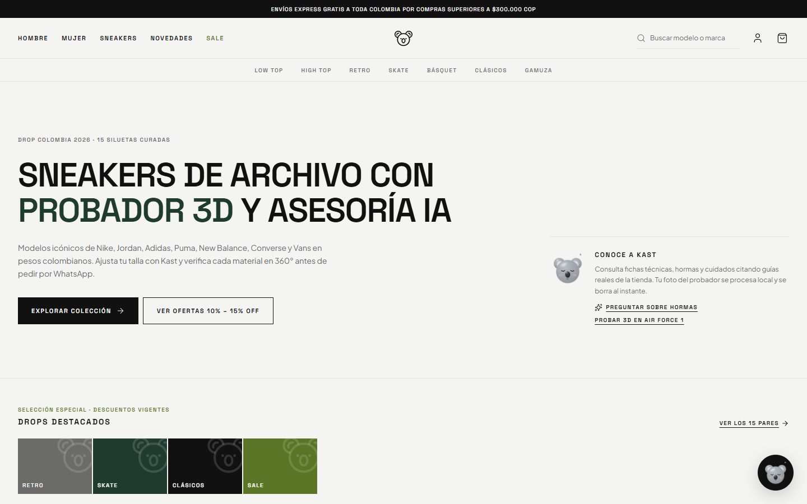
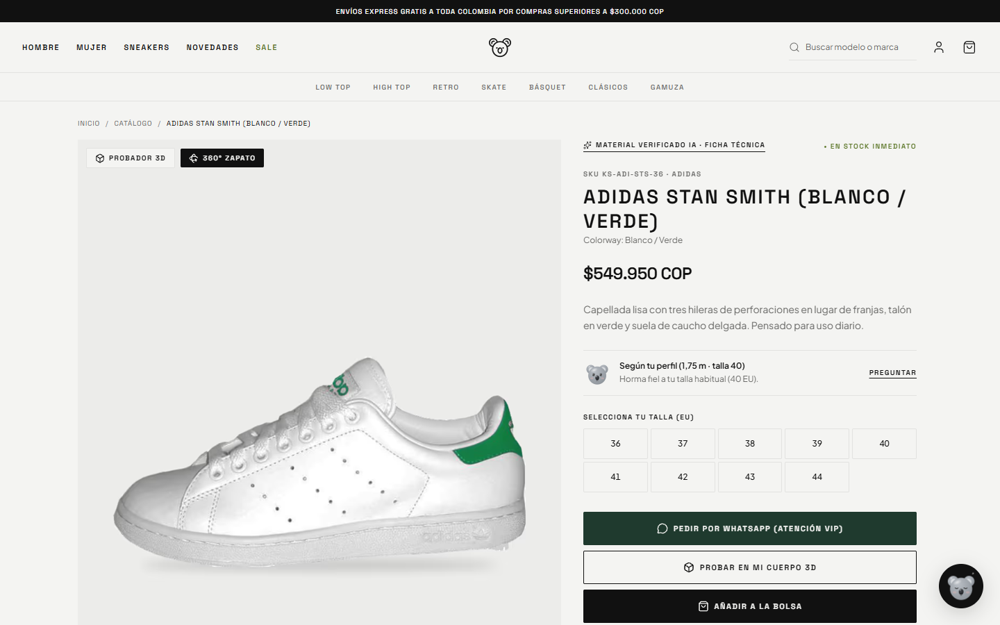
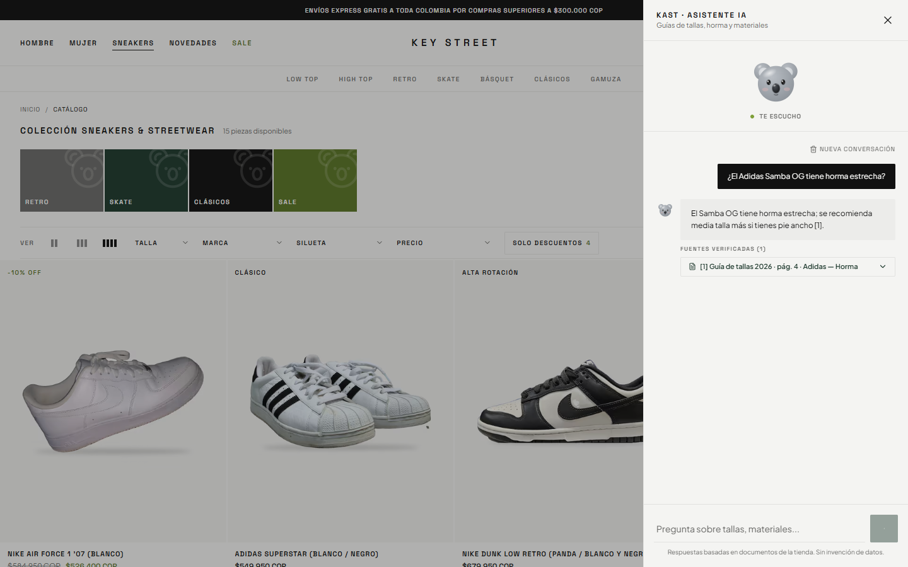
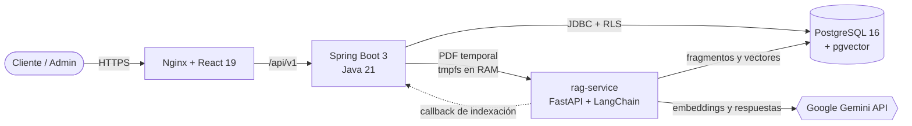
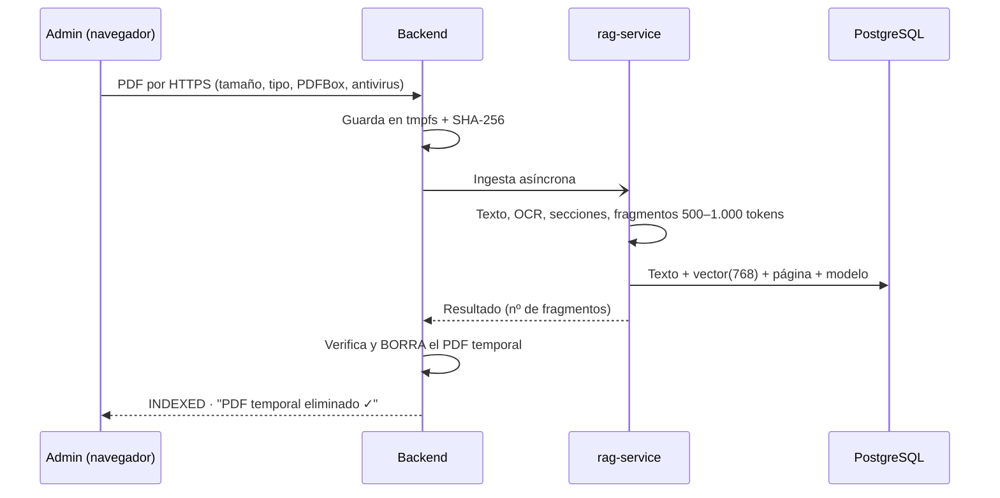

<div align="center">

# Key Street

**Tienda de sneakers multi-tenant con asistente de IA, visor 3D y probador anatómico.**
Catálogo en pesos colombianos, pedidos por WhatsApp y una arquitectura RAG que consulta guías de tallas y fichas técnicas **sin conservar el PDF original**.



</div>

---

## ¿Qué es?

Key Street es una plataforma de e-commerce de calzado pensada para tiendas colombianas, con dos ideas centrales:

1. **Una tienda editorial, rápida y clara**: catálogo en rejilla continua, filtros, descuentos automáticos y pedido por WhatsApp con la talla y el precio calculados en el servidor.
2. **Un asistente (Kast, el koala de la marca) que responde con evidencia**: el administrador sube guías de tallas y fichas técnicas en PDF; el sistema las indexa y Kast contesta citando **documento y página**. El PDF no se guarda: se procesa en memoria y se borra con verificación.

| Catálogo | Detalle de producto |
|---|---|
|  |  |

| Asistente Kast con citas | Móvil |
|---|---|
|  |  |

## Características

**Tienda**
- 15 modelos, precios en COP, 4 descuentos automáticos de 10 % a 15 %, tallas 36–44 con disponibilidad.
- Rejilla continua sin cajas, cambio de foto al pasar el mouse (deslizable en móvil), densidad de 2/3/4 columnas, filtros y orden sincronizados con la URL.
- Pedido por WhatsApp: exige talla, el servidor calcula el precio y arma el mensaje.
- Imágenes en AVIF/WebP con tamaños 480/960/1440 y placeholder cuando no hay foto (sin enlaces rotos).

**Asistente de IA (RAG)**
- Subida de PDF desde el panel de administración, con validación, OCR de páginas escaneadas e indexación asíncrona.
- Búsqueda híbrida (vectorial + texto completo) con filtro obligatorio por tienda.
- Respuestas con citas verificadas contra la base de datos; si no hay evidencia, lo dice.
- Mascota **Kast** con seis estados (dormido, escuchando, pensando, hablando, éxito, error).

**3D**
- Visor 360° del zapato y probador anatómico (estatura, complexión, talla, prendas).
- La foto del probador se procesa **solo en el navegador** y se borra al instante.
- Se carga bajo demanda: no pesa en la portada ni en el catálogo.

**Plataforma**
- Multi-tenant en tres capas (JWT/slug → Hibernate `@TenantId` → *Row-Level Security* de PostgreSQL).
- Panel de administración: documentos, productos (precio, descuento, stock) y auditoría de consultas.

## Arquitectura



**Indexación de un PDF**



**Consulta**: pregunta → embedding con el mismo modelo del índice → búsqueda vectorial + texto con `tenant_id` obligatorio → fusión RRF → Gemini responde con `[n]` → el servidor valida cada cita contra la base.

| Servicio | Tecnología | Función |
|---|---|---|
| `frontend` | React 19, Vite, TypeScript, Tailwind v4, Nginx | Tienda, panel admin, chat, 3D (Three.js / R3F) y MediaPipe diferidos |
| `backend-java` | Spring Boot 3.5, Java 21, JPA/Hibernate 6 | Autenticación, catálogo, pedidos por WhatsApp, ciclo del PDF |
| `rag-service` | Python 3.11, FastAPI, LangChain, PyMuPDF, Tesseract | Extracción, OCR, fragmentación, embeddings, recuperación y generación |
| `postgres` | PostgreSQL 16, pgvector (HNSW) | Datos, vectores `vector(768)`, texto completo `es_unaccent` |

## Seguridad

| Riesgo | Medida |
|---|---|
| Datos de una tienda visibles en otra | `tenant_id` fijado por el servidor + Hibernate `@TenantId` + RLS forzado con roles sin `BYPASSRLS` + pruebas de aislamiento |
| PDF malicioso | Límite de tamaño y páginas, triple verificación de tipo, rechazo de cifrado/JavaScript/archivos incrustados, ClamAV opcional |
| Persistencia indebida del PDF | Volumen `tmpfs` (RAM), borrado verificado y *janitor* periódico; sin binarios en la base |
| Robo de sesión | Token de acceso solo en memoria, refresh en cookie `HttpOnly` rotada, CSP estricta |
| Abuso del asistente | Rate limiting, longitud máxima, respuesta `NO_EVIDENCE` sin llamar al modelo |
| *Prompt injection* desde un PDF | Contexto delimitado, instrucciones fijas y citas validadas |
| Secretos | `.env` fuera de git, generados con `gen-dev-secrets.ps1`, validación al arrancar |
| Foto corporal | Procesamiento 100 % local y liberación inmediata |

El checklist para producción está en [`docs/despliegue.md`](docs/despliegue.md).

## Inicio rápido

Requisitos: **Git**, **Docker Desktop** y **PowerShell**. Opcional: `mkcert`.

```powershell
git clone https://github.com/castillokfirex/KeyStreet.git
cd KeyStreet
.\scripts\gen-dev-secrets.ps1       # crea .env con secretos aleatorios
mkcert -install
mkcert -cert-file infra/certs/dev.crt -key-file infra/certs/dev.key localhost 127.0.0.1
docker compose up -d --build        # la primera vez tarda varios minutos
```

Abre **https://localhost**. Para IA real, pega tu `GEMINI_API_KEY` en `.env`; sin ella todo funciona salvo el asistente y la indexación (modo demo offline: `docker compose -f docker-compose.yml -f docker-compose.e2e.yml up -d --build`).

> ¿Qué es el `.env`, abrirlo en otro PC o llevarlo a producción? Guía completa en **[`docs/despliegue.md`](docs/despliegue.md)**.

### Credenciales de desarrollo

| Usuario | Rol | Contraseña | Acceso |
|---|---|---|---|
| `admin@keystreet.co` | `ADMIN_TENANT` | `KeyStreet2026!` | `https://localhost/admin/login` |
| `cliente@keystreet.co` | `CUSTOMER` | `KeyStreet2026!` | Tienda y asistente |

> ⚠️ Solo para desarrollo: la contraseña es pública. **Cámbiala o elimina estos usuarios antes de publicar el sitio.** Para llamar a la API directamente usa el encabezado `X-Tenant-Slug: key-street`.

## Estructura del repositorio

```
KeyStreet/
├─ frontend/          React + Vite (tienda, admin, chat, visor 3D y probador)
├─ backend-java/      Spring Boot: API REST, seguridad multi-tenant, ciclo del PDF
├─ rag-service/       FastAPI + LangChain: OCR, indexación y consulta con citas
├─ db/                schema.sql · seed.sql · migrations/ (V002: catálogo de 15 modelos) · tests/
├─ infra/             Nginx y certificados de desarrollo
├─ scripts/           Secretos, humo (smoke), catálogo, imágenes, modelos 3D y capturas
├─ assets/            Registros de licencias de imágenes y modelos 3D
├─ docs/              Despliegue, cumplimiento, fuentes de precios, créditos y capturas
├─ PLAN.md            Plan técnico maestro y decisiones de diseño
├─ PROGRESS.md        Checklist por fases y bitácora
└─ Requerimientos.md  Requisitos de la arquitectura RAG
```

## Catálogo y datos

Los 15 modelos se definen en [`scripts/catalog/catalog.json`](scripts/catalog/catalog.json); `node scripts/catalog/build-catalog.mjs` genera la migración **idempotente** [`db/migrations/V002__catalogo_15_modelos.sql`](db/migrations/V002__catalogo_15_modelos.sql) (se puede ejecutar varias veces sin duplicar).

- **Precios:** de lista vigente en tiendas oficiales de Colombia, con URL y fecha en [`docs/catalogo-fuentes.md`](docs/catalogo-fuentes.md). Los marcados *PRUEBA* no son precios reales.
- **Imágenes:** fotos con licencia CC0 / CC BY / CC BY-SA de Wikimedia Commons, normalizadas con `scripts/process-images` (fondo gris uniforme, 4:5, AVIF + WebP). Atribuciones en [`docs/creditos-imagenes.md`](docs/creditos-imagenes.md).
- **3D:** modelo genérico del proyecto por producto, validado con `gltf-validator` y `@gltf-transform`. Ver [`docs/creditos-3d.md`](docs/creditos-3d.md).

Para añadir fotos o modelos reales: copia los originales y regístralos en `assets/products/manifest.json`, luego ejecuta `process-images` y `build-catalog` (los comandos están en cada script).

## Pruebas y calidad

```powershell
# Frontend: tipos, lint, unitarias, build y presupuesto de peso
cd frontend; npm run typecheck; npm run lint; npm run test -- --run; npm run build; npx size-limit

# Backend (integración con Testcontainers + WireMock)
cd backend-java; .\mvnw.cmd -B -ntp verify

# Servicio RAG
cd rag-service; uv run ruff check .; uv run mypy app; uv run pytest -m "not live and not ocr" -q

# Extremo a extremo (requiere el stack en pie)
.\scripts\smoke.ps1
cd frontend; npx playwright test
```

- Presupuesto de rendimiento: JS inicial de `/` ≤ **120 kB** gzip (hoy ~110 kB). `three`, `@react-three/*` y MediaPipe nunca se cargan en `/` ni en `/catalogo`.
- Verificación de base de datos: `db/tests/verify_seed.sql` y `verify_rls.sql`.

## Documentación

| Documento | Contenido |
|---|---|
| [`docs/despliegue.md`](docs/despliegue.md) | `.env`, abrir en otro PC, producción, seguridad y confianza del cliente |
| [`docs/cumplimiento-requerimientos.md`](docs/cumplimiento-requerimientos.md) | Qué cumple de `Requerimientos.md` y qué falta |
| [`PLAN.md`](PLAN.md) | Arquitectura, contratos de API, esquema y decisiones |
| [`PROGRESS.md`](PROGRESS.md) | Avance por fases y bitácora |
| [`docs/catalogo-fuentes.md`](docs/catalogo-fuentes.md) | Fuente y fecha de cada precio |

## Decisiones y estado

- **Gemini en lugar de OpenAI.** `Requerimientos.md` menciona OpenAI; el proyecto usa Google Gemini (embeddings de 768 dimensiones y respuestas), con el proveedor aislado tras una interfaz para poder cambiarlo. Detalle en `PLAN.md` (D2–D4).
- **Persistencia en Java.** `Pgvector.EntityFrameworkCore` es de .NET; en Spring se usa JPA/Hibernate y `JdbcTemplate` para los vectores.
- **Pagos:** hoy el pedido se cierra por WhatsApp; no hay pasarela de pago.

**Pendiente:** verificar el stack completo y la IA real (Gemini) en un equipo con Docker tras la última migración, completar fotos de 4 modelos, reemplazar 2 precios de prueba y preparar el perfil de producción con HTTPS automático. Ver [`docs/cumplimiento-requerimientos.md`](docs/cumplimiento-requerimientos.md).

## Créditos y licencias

Las fotos de producto provienen de Wikimedia Commons bajo licencias libres, con autoría en [`docs/creditos-imagenes.md`](docs/creditos-imagenes.md). Las marcas y logotipos visibles pertenecen a sus titulares; su aparición no implica patrocinio. El proyecto es de uso académico.
