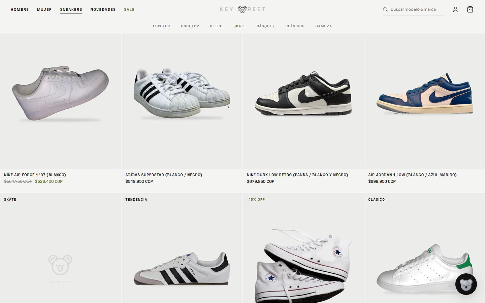
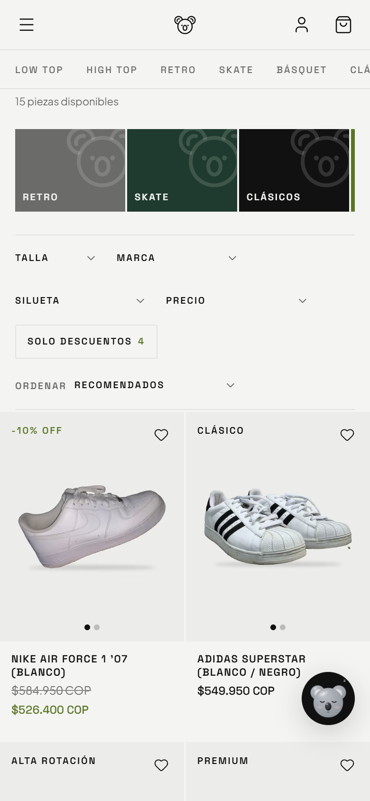
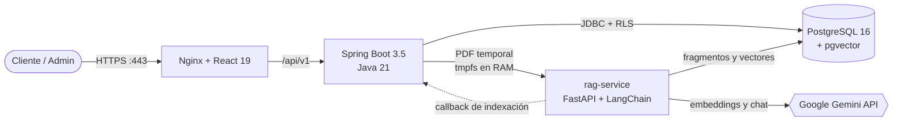
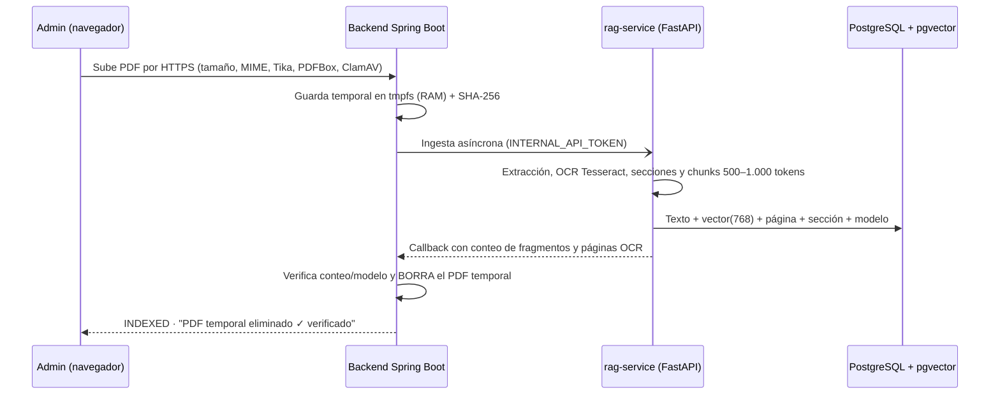

<div align="center">

# KEY STREET

**E-commerce multi-tenant de sneakers en Colombia con asistente IA (RAG), visor 3D 360°, probador anatómico local y pedidos verificados por WhatsApp.**

[](frontend/)
[](backend-java/)
[](backend-java/)
[](rag-service/)
[](db/)
[](rag-service/)
[](frontend/)
[](docker-compose.yml)

<br />

[Inicio rápido](#-inicio-rápido) · [Galería](#-galería-de-la-plataforma) · [Arquitectura](#-arquitectura) · [Asistente Kast](#-asistente-ia-kast-rag-sin-conservar-pdfs) · [Swagger y DBeaver](#-swagger-y-base-de-datos-dbeaver) · [Seguridad](#-seguridad)

<br />


</div>

---

## ✨ ¿Qué hace único a Key Street?

Key Street une una **tienda editorial de sneakers pensada para Colombia** con una **arquitectura RAG segura en la nube** donde el PDF original nunca se persiste:

1. **Tienda rápida, editorial y 100 % fotográfica:** 14 siluetas de 7 marcas (Nike, Jordan, Adidas, New Balance, Converse, Vans y Puma), todas con fotos de estudio optimizadas en AVIF/WebP, precios en COP, 4 descuentos automáticos entre 10 % y 15 % y pedido por WhatsApp con talla obligatoria y precio calculado en el servidor.
2. **Asistente IA Kast con evidencia verificada:** el administrador sube guías de tallas, fichas técnicas o políticas en PDF desde `/admin/documents`; el servidor los procesa en RAM (`tmpfs`), los indexa con OCR + embeddings de 768 dimensiones en `pgvector` y **elimina el PDF original con verificación**. Kast responde citando **documento y página** — y si no hay evidencia, lo dice sin inventar.
3. **Visor 3D 360° y Probador Anatómico 100 % privado:** modelos `.glb` interactivos con puntos calientes de materiales y un probador corporal personalizable (estatura, complexión, prendas y foto opcional procesada únicamente en el navegador con MediaPipe, eliminada al instante sin enviarse a la red).

---

## 🖼️ Galería de la plataforma

<table>
  <tr>
    <td width="50%" align="center">
      <strong>Catálogo editorial y filtros sincronizados</strong><br /><br />
      
    </td>
    <td width="50%" align="center">
      <strong>Ficha de producto, tallas EU y WhatsApp VIP</strong><br /><br />
      
    </td>
  </tr>
  <tr>
    <td width="65%" align="center">
      <strong>Asistente Kast con citas verificadas por página</strong><br /><br />
      
    </td>
    <td width="35%" align="center">
      <strong>Experiencia móvil responsive</strong><br /><br />
      
    </td>
  </tr>
</table>

---

## 🧩 Características principales

| Área | Capacidades implementadas |
|---|---|
| **Tienda y Catálogo** | 14 modelos activos (7 marcas), tallas `EU 36–44` (`126` variantes), precios reales en COP, 4 descuentos automáticos (`10 %–15 %`), rejilla continua de 2/3/4 columnas, cambio de ángulo al pasar el mouse, búsqueda y filtros sincronizados en URL. |
| **Pedidos por WhatsApp** | Exige talla seleccionada, valida stock y calcula totales/descuentos en el backend (`POST /api/v1/public/orders/whatsapp-intent`), registra trazabilidad en `whatsapp_order_intents` y abre `wa.me` con el mensaje armado por el servidor. |
| **Asistente IA (Kast)** | Subida segura de PDFs (PDFBox + Tika + ClamAV opcional), OCR Tesseract (`spa+eng`) para PDFs escaneados, fragmentos de 500–1.000 tokens con solape, búsqueda híbrida vectorial + texto completo `es_unaccent` (RRF), respuestas con citas validadas y estado `NO_EVIDENCE` sin alucinaciones. |
| **Visor 3D y Probador** | Visor 360° Three.js / React Three Fiber con *hotspots* de materiales y probador anatómico con avatar personalizable y estimación postural MediaPipe 100 % en navegador; carga diferida (`lazy`) para mantener la portada ligera (`≤ 120 kB` gzip). |
| **Multi-tenant & Admin** | Aislamiento en 3 capas (`X-Tenant-Slug` / JWT → Hibernate `@TenantId` → PostgreSQL *Row-Level Security* forzado), autenticación JWT + refresh rotado en cookie `HttpOnly` y panel admin para **Documentos**, **Productos** y **Auditoría RAG**. |

---

## 🏗️ Arquitectura



### Ciclo efímero de un PDF (sin almacenar el binario)



| Servicio | Stack | Puerto | Función |
|---|---|---|---|
| `frontend` | React 19, Vite, TypeScript, Tailwind v4, Nginx | `80` / `443` | Tienda pública, panel admin, chat Kast, visor 3D y probador |
| `backend-java` | Spring Boot 3.5, Java 21, JPA/Hibernate 6, PDFBox | `8080` *(local)* | API REST, JWT, catálogo, pedidos WhatsApp y ciclo del PDF |
| `rag-service` | Python 3.11, FastAPI, LangChain, PyMuPDF, Tesseract | `8000` *(interno)* | OCR, fragmentación, embeddings Gemini, búsqueda híbrida y citas |
| `postgres` | PostgreSQL 16 + `pgvector` (HNSW + GIN `es_unaccent`) | `5432` *(local)* | Datos transaccionales, `vector(768)`, auditoría y RLS |

---

## 🚀 Inicio rápido

Requisitos: **Git**, **Docker Desktop** y **PowerShell**. Opcional: `mkcert` para certificados TLS locales sin advertencias.

```powershell
git clone https://github.com/castillokfirex/KeyStreet.git
cd KeyStreet
.\scripts\gen-dev-secrets.ps1       # crea .env con secretos aleatorios (nunca se sube a git)
mkcert -install
mkcert -cert-file infra/certs/dev.crt -key-file infra/certs/dev.key localhost 127.0.0.1
docker compose up -d --build        # la primera compilación tarda unos minutos
docker compose ps                   # confirmar los 4 servicios en estado "healthy"
```

- **Tienda pública:** `https://localhost`
- **Panel administrativo:** `https://localhost/admin/login`
- **Swagger UI (OpenAPI):** `http://localhost:8080/swagger-ui/index.html`

> **IA real vs. modo demo offline:** pega tu `GEMINI_API_KEY` en `.env` con `AI_PROVIDER=gemini` para usar Google Gemini real. Sin clave, puedes probar en modo demo determinista con `docker compose -f docker-compose.yml -f docker-compose.e2e.yml up -d --build`. Guía completa de variables y producción en [`docs/despliegue.md`](docs/despliegue.md).

### Credenciales de desarrollo

| Usuario | Rol | Contraseña | Uso |
|---|---|---|---|
| `admin@keystreet.co` | `ADMIN_TENANT` | `KeyStreet2026!` | Ingreso al panel admin (`https://localhost/admin/login`) y endpoints `/api/v1/admin/**` |
| `cliente@keystreet.co` | `CUSTOMER` | `KeyStreet2026!` | Pruebas de autenticación por API (`/api/v1/auth/login`, `/api/v1/me`) y verificación `403` en rutas admin |

> ⚠️ Solo para desarrollo local. **Cambia o elimina estos usuarios antes de publicar en producción.** En llamadas directas a la API envía el encabezado `X-Tenant-Slug: key-street`.

---

## 🔌 Swagger y Base de Datos (DBeaver)

### Swagger UI
- Abre **`http://localhost:8080/swagger-ui/index.html`** *(directo al backend; Nginx en `:443` solo proxea `/api/`)*.
- Para probar rutas protegidas: inicia sesión en `POST /api/v1/auth/login` (header `X-Tenant-Slug: key-street`) y pega el `accessToken` en **Authorize** (`Bearer`).

### DBeaver / psql
| Parámetro | Valor en local |
|---|---|
| **Host / Puerto** | `localhost` · `5432` |
| **Base de datos** | `keystreet` |
| **Usuario / Clave** | `postgres` · valor de `POSTGRES_PASSWORD` en tu `.env` |

También puedes abrir una consola `psql` directamente sin instalar clientes externos:
```powershell
docker compose exec postgres psql -U postgres -d keystreet
```

---

## 🤖 Asistente IA Kast (RAG sin conservar PDFs)

Los documentos oficiales de prueba y demostración están en [`rag-service/tests/fixtures/`](rag-service/tests/fixtures/):
- [`guia_tallas.pdf`](rag-service/tests/fixtures/guia_tallas.pdf): fichas técnicas, materiales, pesos, precios en COP, equivalencias EU 36–44 y guía de regalos para los 14 modelos activos.
- [`ficha_escaneada.pdf`](rag-service/tests/fixtures/ficha_escaneada.pdf): documento solo-imagen (sin capa de texto) para demostrar extracción OCR con Tesseract sobre garantías, envíos en Colombia y cuidado de gamuza/cuero/lona.

Para indexarlos desde la interfaz, entra a `https://localhost/admin/documents`, súbelos y verifica el estado `INDEXED` junto a `eliminado ✓ verificado`.

---

## 🔐 Seguridad

| Riesgo | Medida implementada |
|---|---|
| **Fuga entre tiendas** | `tenant_id` resuelto en servidor + Hibernate `@TenantId` + PostgreSQL RLS forzado con roles sin `BYPASSRLS` |
| **PDF malicioso** | Límite de tamaño/páginas, triple validación (`Content-Type`, Apache Tika, firma `%PDF-`), rechazo de cifrado/JS/`/Launch`/embebidos en PDFBox y ClamAV opcional |
| **Persistencia del PDF** | Almacenamiento efímero en `tmpfs` (RAM), borrado verificado al terminar la ingesta y *janitor* periódico; cero binarios en BD |
| **Robo de sesión** | *Access token* JWT (15 min) solo en memoria + *refresh token* rotado en cookie `HttpOnly` + CSP estricta en Nginx |
| **Alucinaciones / Injection** | Contexto delimitado, `temperature=0.1`, validación de citas `[n]` contra fragmentos reales en BD y respuesta `NO_EVIDENCE` cuando falta soporte |
| **Privacidad biométrica** | La foto del probador 3D se procesa 100 % en el navegador y se revoca el `blob:` al instante |

---

## 🧪 Pruebas y calidad

```powershell
# Frontend: tipos, lint, unitarias, build y presupuesto de peso (<= 120 kB gzip en /)
cd frontend; npm run typecheck; npm run lint; npm run test -- --run; npm run build; npx size-limit

# Backend (integración con Testcontainers + WireMock)
cd backend-java; .\mvnw.cmd -B -ntp verify

# Servicio RAG
uv --directory rag-service run ruff check .
uv --directory rag-service run python -m mypy app
uv --directory rag-service run python -m pytest -m "not live and not ocr" -q

# Base de datos y extremo a extremo (con el stack levantado)
docker compose exec -T postgres psql -U postgres -d keystreet -v ON_ERROR_STOP=1 -f /db-tests/verify_seed.sql
docker compose exec -T postgres psql -U postgres -d keystreet -v ON_ERROR_STOP=1 -f /db-tests/verify_rls.sql
.\scripts\smoke.ps1
cd frontend; npx playwright test
```

---

## 📂 Estructura y documentación

```text
KeyStreet/
├─ frontend/          React 19 + Vite (tienda, admin, chat Kast, visor 3D y probador)
├─ backend-java/      Spring Boot 3.5: API REST, seguridad multi-tenant, ciclo del PDF
├─ rag-service/       FastAPI + LangChain: OCR, chunking, Gemini embeddings y citas
├─ db/                schema.sql · seed.sql · migrations/ · tests/ (seed y RLS)
├─ infra/             Nginx (reverse proxy + TLS) y certificados de desarrollo
├─ scripts/           Secretos, smoke test, catálogo, procesamiento de imágenes, 3D y capturas
├─ assets/            Manifiestos de licencias de imágenes y modelos 3D
└─ docs/              Despliegue, cumplimiento RAG, fuentes de precios, créditos y capturas
```

| Documento | Contenido |
|---|---|
| [`docs/despliegue.md`](docs/despliegue.md) | `.env`, abrir en otro PC, producción en VPS y checklist de seguridad |
| [`docs/cumplimiento-requerimientos.md`](docs/cumplimiento-requerimientos.md) | Trazabilidad frente a [`Requerimientos.md`](Requerimientos.md) |
| [`docs/catalogo-fuentes.md`](docs/catalogo-fuentes.md) | Precios en COP, referencias oficiales y modelos retirados |
| [`docs/creditos-imagenes.md`](docs/creditos-imagenes.md) | Licencias y fuentes de imágenes del catálogo |
| [`docs/creditos-3d.md`](docs/creditos-3d.md) | Validación y autoría de modelos `.glb` |
| [`PLAN.md`](PLAN.md) · [`PROGRESS.md`](PROGRESS.md) | Plan técnico maestro y bitácora por fases |

---

## 📄 Créditos y licencias

Las imágenes de producto de Wikimedia Commons respetan sus licencias libres acreditadas en [`docs/creditos-imagenes.md`](docs/creditos-imagenes.md). Las marcas y logotipos visibles pertenecen a sus respectivos titulares y su aparición en este repositorio es estrictamente con fines académicos.
